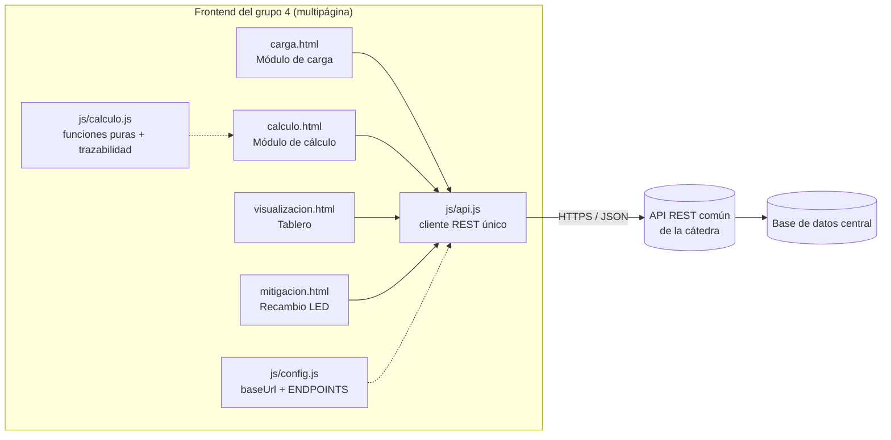
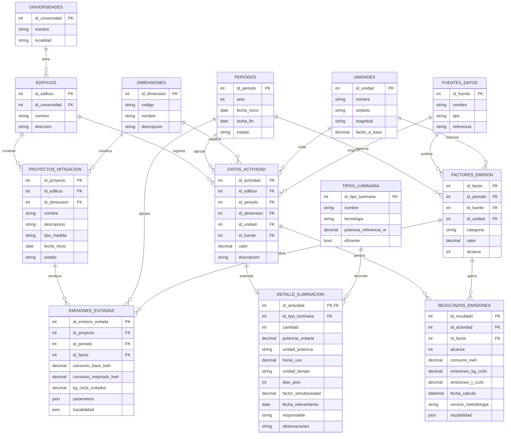

# Campus CO₂: Dimensión 4, Infraestructura y edificios

## Análisis de iluminación por edificio: endpoints y modelo de datos

**Cátedra:** Green Software, UTN Facultad Regional Córdoba
**Módulo:** frontend de carga, cálculo y visualización (HTML, CSS y JavaScript)
**Versión de la metodología:** `ILUM-1.0`

> Este documento describe **qué necesita consumir el módulo de la API REST común** que desarrolla la cátedra. El grupo **no desarrolla una API ni una base de datos propias**. Las rutas son una propuesta y se pueden adaptar. En el frontend están centralizadas en `js/config.js` (objeto `ENDPOINTS`), así que un cambio de ruta no obliga a tocar el resto del código.

---

## 1. Modelo de medición (resumen)

| Aspecto | Definición |
|---|---|
| Qué se mide | Emisiones de GEI (CO₂e) por el consumo eléctrico de la iluminación de cada edificio, por tipo y tecnología de luminaria |
| Alcance | **Alcance 2**: electricidad comprada a la red, con el método basado en ubicación (GHG Protocol / ISO 14064-1). Los recambios a LED se informan como **emisiones evitadas**, por separado |
| Periodicidad | **Anual**: un período equivale a un año calendario |
| Variables | Cantidad de luminarias, potencia unitaria, horas de uso, días de uso, simultaneidad y factor de emisión de la red |
| Unidades | W / kW, h/día / h/año, días/año, %, kWh, kgCO₂e/kWh (también se aceptan tCO₂e/MWh, kgCO₂e/MWh y gCO₂e/kWh), kgCO₂e / tCO₂e |

### Fórmulas

```
P_inst [kW]          = cantidad × P_unitaria [W] ÷ 1000
h_año  [h]           = horas_día × días_año            (o se carga directo en h/año)
E      [kWh]         = P_inst × h_año × (simultaneidad ÷ 100)
FE     [kgCO2e/kWh]  = valor del factor normalizado    (1 tCO2e/MWh = 1 kgCO2e/kWh)
Emisiones [kgCO2e]   = E × FE
Emisiones [tCO2e]    = kgCO2e ÷ 1000
Evitadas  [kgCO2e]   = (E_base − E_mejorado) × FE
```

---

## 2. Arquitectura de la integración



- Todas las llamadas pasan por `js/api.js`. Ninguna página llama a `fetch` directamente.
- Con **modo demostración** (`useMock: true`) las respuestas salen de `js/mock-data.js`, que imita la API esperada. Sirve para presentar el módulo sin servidor. Se desactiva desde la página **Configuración API**.
- El cálculo se hace en el frontend (`js/calculo.js`) y **se envía el resultado junto con su trazabilidad**. Así la API guarda cómo se obtuvo cada número.

---

## 3. Convenciones de la API (lo que espera el frontend)

| Tema | Convención |
|---|---|
| URL base | `https://<servidor-catedra>/api/v1` (se configura en la página **Configuración API**) |
| Formato | JSON UTF-8, `Content-Type: application/json` |
| Autenticación | Opcional: `Authorization: Bearer <token>` |
| Nombres | `snake_case`. Claves primarias `id_<entidad>` |
| Respuesta de listas | Arreglo JSON **o** `{ "data": [ ... ] }` (el cliente acepta los dos) |
| Filtros | Query string, por ejemplo `?id_periodo=4&id_dimension=4` |
| Fechas | ISO 8601 (`2026-05-15`, `2026-06-01T12:00:00Z`) |
| Números | Punto decimal, sin separador de miles |
| Códigos HTTP | `200` OK · `201` creado · `204` eliminado · `400` validación · `401/403` autenticación · `404` no existe · `409` conflicto · `500` error |
| Errores | `{ "message": "texto legible", "errors": { "campo": "detalle" } }` (el frontend muestra `message`) |
| CORS | La API debe permitir el origen desde el que se sirve el frontend |

---

## 4. Endpoints

### 4.1 Resumen

| # | Método | Ruta | Uso en el módulo | Entidad |
|---|---|---|---|---|
| 1 | GET | `/health` | Probar la conexión | — |
| 2 | GET | `/universidades` | Mostrar la universidad | UNIVERSIDADES |
| 3 | GET | `/edificios?id_universidad={id}` | Selector de edificio | EDIFICIOS |
| 4 | GET | `/periodos` | Selector de período anual | PERIODOS |
| 5 | GET | `/dimensiones?codigo=INFRA_ILUMINACION` | Obtener `id_dimension` | DIMENSIONES |
| 6 | GET | `/unidades` | Unidad del dato de actividad (kWh) | UNIDADES |
| 7 | GET | `/fuentes-datos` | Selector de fuente del dato | FUENTES_DATOS |
| 8 | GET | `/factores-emision?id_periodo={id}&categoria=electricidad_red` | **Consultar el factor de emisión** | FACTORES_EMISION |
| 9 | GET | `/tipos-luminaria` | Catálogo de luminarias y potencias de referencia | TIPOS_LUMINARIA ⭐ |
| 10 | GET | `/datos-actividad?id_dimension=4&id_periodo=&id_edificio=` | Listar relevamientos | DATOS_ACTIVIDAD + DETALLE_ILUMINACION |
| 11 | POST | `/datos-actividad` | **Enviar un dato relevado** | DATOS_ACTIVIDAD + DETALLE_ILUMINACION |
| 12 | PUT | `/datos-actividad/{id_actividad}` | Corregir un dato | ídem |
| 13 | DELETE | `/datos-actividad/{id_actividad}` | Eliminar un dato | ídem |
| 14 | GET | `/resultados-emisiones?id_dimension=4&id_periodo=` | Tablero y estado de cálculo | RESULTADOS_EMISIONES |
| 15 | POST | `/resultados-emisiones` | **Enviar el cálculo con su trazabilidad** | RESULTADOS_EMISIONES |
| 16 | GET | `/proyectos-mitigacion?id_dimension=4` | Listar proyectos LED | PROYECTOS_MITIGACION |
| 17 | POST | `/proyectos-mitigacion` | Registrar un proyecto | PROYECTOS_MITIGACION |
| 18 | GET | `/emisiones-evitadas?id_proyecto=&id_periodo=` | KPI de emisiones evitadas | EMISIONES_EVITADAS |
| 19 | POST | `/emisiones-evitadas` | Enviar las emisiones evitadas calculadas | EMISIONES_EVITADAS |
| 20 | POST | `/tipos-luminaria` | ABM: alta de tipo de luminaria | TIPOS_LUMINARIA ⭐ |
| 21 | PUT | `/tipos-luminaria/{id_tipo_luminaria}` | ABM: modificación | TIPOS_LUMINARIA ⭐ |
| 22 | DELETE | `/tipos-luminaria/{id_tipo_luminaria}` | ABM: baja (`409` si está en uso) | TIPOS_LUMINARIA ⭐ |
| 23 | POST | `/fuentes-datos` | ABM: alta de fuente de datos | FUENTES_DATOS |
| 24 | PUT | `/fuentes-datos/{id_fuente}` | ABM: modificación | FUENTES_DATOS |
| 25 | DELETE | `/fuentes-datos/{id_fuente}` | ABM: baja (`409` si está en uso) | FUENTES_DATOS |
| 26 | POST | `/universidades` | ABM: alta de universidad | UNIVERSIDADES |
| 27 | PUT | `/universidades/{id_universidad}` | ABM: modificación | UNIVERSIDADES |
| 28 | DELETE | `/universidades/{id_universidad}` | ABM: baja (`409` si tiene edificios) | UNIVERSIDADES |
| 29 | POST | `/edificios` | ABM: alta de edificio | EDIFICIOS |
| 30 | PUT | `/edificios/{id_edificio}` | ABM: modificación | EDIFICIOS |
| 31 | DELETE | `/edificios/{id_edificio}` | ABM: baja (`409` si está en uso) | EDIFICIOS |

Los cuerpos y validaciones de los endpoints de ABM (20 a 31) están en `Endpoints_para_la_catedra.md`, sección 7.

**Dimensión:** DIMENSIONES es la entidad central que separa los datos de los 15 grupos. El módulo siempre usa la dimensión 4 (`INFRA_ILUMINACION`): obtiene su `id_dimension` de la API y lo completa solo en cada envío. No es un campo del formulario de carga.

⭐ Catálogo propio de la dimensión 4. Pedimos que la cátedra los aloje en la base central, o que indique cómo modelarlos con sus entidades genéricas.

### 4.2 Catálogos (consulta)

#### `GET /edificios?id_universidad=1`

```json
[
  { "id_edificio": 1, "id_universidad": 1, "nombre": "Edificio Central", "direccion": "Maestro M. López esq. Cruz Roja Argentina" }
]
```

#### `GET /periodos`

```json
[ { "id_periodo": 4, "anio": 2026, "fecha_inicio": "2026-01-01", "fecha_fin": "2026-12-31", "estado": "abierto" } ]
```

#### `GET /dimensiones?codigo=INFRA_ILUMINACION`

```json
[ { "id_dimension": 4, "codigo": "INFRA_ILUMINACION", "nombre": "Infraestructura y edificios", "descripcion": "Análisis de iluminación por edificio" } ]
```

#### `GET /unidades`

```json
[
  { "id_unidad": 1, "nombre": "Watt", "simbolo": "W", "magnitud": "potencia", "factor_a_base": 1 },
  { "id_unidad": 4, "nombre": "Kilowatt-hora", "simbolo": "kWh", "magnitud": "energia", "factor_a_base": 1 },
  { "id_unidad": 10, "nombre": "kgCO2e por kWh", "simbolo": "kgCO2e/kWh", "magnitud": "factor", "factor_a_base": 1 }
]
```

#### `GET /fuentes-datos`

```json
[ { "id_fuente": 1, "nombre": "Relevamiento presencial", "tipo": "relevamiento", "referencia": "Planilla de campo" } ]
```

#### `GET /factores-emision?id_periodo=4&categoria=electricidad_red` (consulta del factor de emisión)

```json
[
  {
    "id_factor": 4,
    "id_periodo": 4,
    "anio": 2026,
    "categoria": "electricidad_red",
    "valor": 0.283,
    "unidad": "tCO2e/MWh",
    "id_unidad": 11,
    "id_fuente": 5,
    "fuente_nombre": "Factor de emisión de la red argentina – Secretaría de Energía",
    "alcance": 2
  }
]
```

> El frontend normaliza `valor` según `unidad` (`kgCO2e/kWh`, `tCO2e/MWh`, `kgCO2e/MWh`, `gCO2e/kWh`). Para el JOIN alcanza con `id_unidad`, pero pedimos que la respuesta incluya también `unidad` (el símbolo) y `fuente_nombre`, que se muestran en la trazabilidad.

#### `GET /tipos-luminaria`

```json
[
  { "id_tipo_luminaria": 1, "nombre": "Tubo fluorescente T8 120 cm", "tecnologia": "Fluorescente", "potencia_referencia_w": 36, "eficiente": false },
  { "id_tipo_luminaria": 2, "nombre": "Tubo LED T8 120 cm", "tecnologia": "LED", "potencia_referencia_w": 18, "eficiente": true }
]
```

### 4.3 Datos de actividad (envío de los datos relevados)

#### `POST /datos-actividad`

El registro sigue la estructura **genérica** de la entidad central (`valor` + `id_unidad`). El detalle propio de iluminación va anidado en `detalle_iluminacion` (relación 1:1).

**Request**

```json
{
  "id_edificio": 3,
  "id_periodo": 4,
  "id_dimension": 4,
  "id_fuente": 1,
  "id_unidad": 4,
  "valor": 259.2,
  "descripcion": "Plafón LED circular – Depósito",
  "detalle_iluminacion": {
    "id_tipo_luminaria": 4,
    "cantidad": 12,
    "potencia_unitaria": 18,
    "unidad_potencia": "W",
    "horas_uso": 6,
    "unidad_tiempo": "h/día",
    "dias_anio": 200,
    "factor_simultaneidad": 100,
    "fecha_relevamiento": "2026-05-15",
    "responsable": "Grupo 4 – Iluminación",
    "observaciones": "Potencia tomada de la etiqueta"
  }
}
```

**Response `201 Created`**: el mismo objeto con `id_actividad` y `created_at`.

Validaciones que hace el frontend (sugerimos repetirlas en la API):

| Campo | Regla |
|---|---|
| `id_edificio`, `id_periodo`, `id_fuente`, `id_tipo_luminaria` | Obligatorios y existentes |
| `cantidad` | Entero entre 1 y 10.000 |
| `potencia_unitaria` + `unidad_potencia` | Entre 0,5 W y 2.000 W después de convertir. `unidad_potencia` ∈ {`W`, `kW`} |
| `horas_uso` | Entre 0,5 y 24 si `unidad_tiempo = "h/día"`. Entre 1 y 8.760/8.784 si es `"h/año"` |
| `dias_anio` | Entero entre 1 y 365/366. Es `null` si `unidad_tiempo = "h/año"` |
| `factor_simultaneidad` | Entre 1 y 100 (%) |
| `fecha_relevamiento` | Dentro del año del período y no posterior a hoy |
| `responsable` | Al menos 3 caracteres |
| `valor` | kWh/año calculado con la fórmula del punto 1 |

#### `PUT /datos-actividad/{id_actividad}`

Mismo cuerpo que el POST. Devuelve `200` con el registro y `updated_at`. Si `updated_at` es posterior al último resultado, el frontend marca el dato como **“Recalcular”**.

#### `DELETE /datos-actividad/{id_actividad}`

Devuelve `204`. La API debería borrar en cascada el detalle y los resultados asociados, o rechazar la operación con `409`.

#### `GET /datos-actividad?id_dimension=4&id_periodo=4`

Devuelve un arreglo de objetos como los del POST, con `id_actividad`, `created_at` y `updated_at`.

### 4.4 Resultados de emisiones (envío de los cálculos)

#### `POST /resultados-emisiones`

```json
{
  "id_actividad": 41,
  "id_factor": 4,
  "id_dimension": 4,
  "alcance": 2,
  "consumo_kwh": 259.2,
  "emisiones_kg_co2e": 73.3536,
  "emisiones_t_co2e": 0.073354,
  "fecha_calculo": "2026-10-20T14:05:00.000Z",
  "version_metodologia": "ILUM-1.0",
  "trazabilidad": {
    "metodo": "Alcance 2 – basado en ubicación (GHG Protocol Scope 2 Guidance)",
    "formula_general": "E [kgCO2e] = (cantidad × P_unitaria[W] ÷ 1000) × horas_año × simultaneidad × FE [kgCO2e/kWh]",
    "entradas": {
      "edificio": "Biblioteca", "periodo": 2026, "tipo_luminaria": "Plafón LED circular",
      "cantidad": 12, "potencia_unitaria": 18, "unidad_potencia": "W",
      "horas_uso": 6, "unidad_tiempo": "h/día", "dias_anio": 200, "factor_simultaneidad": 100
    },
    "factor_emision": {
      "id_factor": 4, "valor_original": 0.283, "unidad_original": "tCO2e/MWh",
      "valor_normalizado_kg_kwh": 0.283, "fuente": "…", "anio": 2026
    },
    "conversiones": [
      { "magnitud": "Potencia instalada", "de": "216 W", "a": "0,216 kW", "regla": "kW = W ÷ 1000" },
      { "magnitud": "Tiempo de uso", "de": "6 h/día × 200 días/año", "a": "1.200 h/año", "regla": "h/año = h/día × días/año" },
      { "magnitud": "Factor de emisión", "de": "0,283 tCO2e/MWh", "a": "0,283 kgCO2e/kWh", "regla": "1 tCO2e/MWh = 1 kgCO2e/kWh" },
      { "magnitud": "Emisiones", "de": "73,354 kgCO2e", "a": "0,073354 tCO2e", "regla": "t = kg ÷ 1000" }
    ],
    "pasos": [
      { "descripcion": "Potencia instalada", "formula": "12 luminarias × 18 W ÷ 1000", "resultado": "0,216 kW" },
      { "descripcion": "Horas de uso anuales", "formula": "h/año = h/día × días/año", "resultado": "1.200 h/año" },
      { "descripcion": "Consumo eléctrico anual", "formula": "0,216 kW × 1.200 h × 100 % simultaneidad", "resultado": "259,2 kWh" },
      { "descripcion": "Aplicación del factor de emisión", "formula": "259,2 kWh × 0,283 kgCO2e/kWh", "resultado": "73,354 kgCO2e" },
      { "descripcion": "Conversión a toneladas", "formula": "73,354 kgCO2e ÷ 1000", "resultado": "0,073354 tCO2e" }
    ]
  }
}
```

**Response `201`**: el objeto con `id_resultado`. **No se sobrescriben resultados.** Cada recálculo crea un registro nuevo y el frontend usa el más reciente (`fecha_calculo`) por cada `id_actividad`. Así queda el historial completo.

#### `GET /resultados-emisiones?id_dimension=4&id_periodo=4`

Devuelve un arreglo de resultados como el anterior, cada uno con su `id_resultado`.

### 4.5 Mitigación y emisiones evitadas

#### `POST /proyectos-mitigacion`

```json
{
  "id_edificio": 2,
  "id_dimension": 4,
  "nombre": "Recambio LED – Pasillos",
  "descripcion": "Reemplazo de 24 × LFC 20 W por plafones LED 18 W.",
  "tipo_medida": "Recambio a LED",
  "fecha_inicio": "2026-10-20",
  "estado": "Planificado"
}
```

`estado` ∈ {`Planificado`, `En evaluación`, `En ejecución`, `Implementado`}. Devuelve `201` con `id_proyecto`.

#### `POST /emisiones-evitadas`

```json
{
  "id_proyecto": 2,
  "id_periodo": 4,
  "id_factor": 4,
  "consumo_base_kwh": 1612.8,
  "consumo_mejorado_kwh": 1451.52,
  "kg_co2e_evitados": 45.6422,
  "parametros": {
    "cantidad_base": 24, "potencia_base": 20, "cantidad_nueva": 24, "potencia_nueva": 18,
    "horas_uso": 14, "unidad_tiempo": "h/día", "dias_anio": 240,
    "id_tipo_base": 5, "id_tipo_nuevo": 4
  },
  "trazabilidad": { "metodo": "Emisiones evitadas = (consumo base − consumo mejorado) × FE", "pasos": [ "…" ] }
}
```

---

## 5. Modelo de datos

### 5.1 Entidades y atributos

**Entidades centrales** (las provee la cátedra y el módulo las consume):

| Entidad | Atributos |
|---|---|
| UNIVERSIDADES | **id_universidad**, nombre, localidad |
| EDIFICIOS | **id_edificio**, *id_universidad*, nombre, direccion |
| PERIODOS | **id_periodo**, anio, fecha_inicio, fecha_fin, estado |
| DIMENSIONES | **id_dimension**, codigo, nombre, descripcion |
| UNIDADES | **id_unidad**, nombre, simbolo, magnitud, factor_a_base |
| FUENTES_DATOS | **id_fuente**, nombre, tipo, referencia |
| FACTORES_EMISION | **id_factor**, *id_periodo*, *id_fuente*, *id_unidad*, categoria, valor, alcance |
| DATOS_ACTIVIDAD | **id_actividad**, *id_edificio*, *id_periodo*, *id_dimension*, *id_unidad*, *id_fuente*, valor, descripcion, created_at, updated_at |
| RESULTADOS_EMISIONES | **id_resultado**, *id_actividad*, *id_factor*, alcance, consumo_kwh, emisiones_kg_co2e, emisiones_t_co2e, fecha_calculo, version_metodologia, trazabilidad |
| PROYECTOS_MITIGACION | **id_proyecto**, *id_edificio*, *id_dimension*, nombre, descripcion, tipo_medida, fecha_inicio, estado |
| EMISIONES_EVITADAS | **id_emision_evitada**, *id_proyecto*, *id_periodo*, *id_factor*, consumo_base_kwh, consumo_mejorado_kwh, kg_co2e_evitados, parametros, trazabilidad |

**Entidades propias de la dimensión 4** (extienden el modelo central):

| Entidad | Atributos |
|---|---|
| TIPOS_LUMINARIA | **id_tipo_luminaria**, nombre, tecnologia, potencia_referencia_w, eficiente |
| DETALLE_ILUMINACION | **_id_actividad_** (PK y FK), *id_tipo_luminaria*, cantidad, potencia_unitaria, unidad_potencia, horas_uso, unidad_tiempo, dias_anio, factor_simultaneidad, fecha_relevamiento, responsable, observaciones |

**negrita** = clave primaria · *cursiva* = clave foránea

### 5.2 Relaciones con las entidades centrales

| Relación | Cardinalidad | Descripción |
|---|---|---|
| UNIVERSIDADES → EDIFICIOS | 1 : N | Una universidad tiene muchos edificios |
| EDIFICIOS → DATOS_ACTIVIDAD | 1 : N | Los relevamientos se imputan a un edificio |
| PERIODOS → DATOS_ACTIVIDAD | 1 : N | Cada dato pertenece a un año |
| DIMENSIONES → DATOS_ACTIVIDAD | 1 : N | Identifica a la dimensión 4 (`INFRA_ILUMINACION`); el sistema completa `id_dimension` |
| UNIDADES → DATOS_ACTIVIDAD | 1 : N | `valor` se expresa en kWh |
| FUENTES_DATOS → DATOS_ACTIVIDAD | 1 : N | Origen y calidad del dato |
| **DATOS_ACTIVIDAD → DETALLE_ILUMINACION** ⭐ | **1 : 0..1** | Extensión con las variables propias de la iluminación |
| TIPOS_LUMINARIA → DETALLE_ILUMINACION ⭐ | 1 : N | Tecnología y potencia de referencia |
| PERIODOS / FUENTES_DATOS / UNIDADES → FACTORES_EMISION | 1 : N | Un factor por año, con su fuente y su unidad |
| DATOS_ACTIVIDAD → RESULTADOS_EMISIONES | 1 : N | Historial de cálculos (versionado) |
| FACTORES_EMISION → RESULTADOS_EMISIONES | 1 : N | Factor usado en el cálculo (trazabilidad) |
| EDIFICIOS / DIMENSIONES → PROYECTOS_MITIGACION | 1 : N | Proyecto LED en un edificio |
| PROYECTOS_MITIGACION → EMISIONES_EVITADAS | 1 : N | Emisiones evitadas por año |
| PERIODOS / FACTORES_EMISION → EMISIONES_EVITADAS | 1 : N | Año y factor aplicados |

### 5.3 Diccionario de datos

#### TIPOS_LUMINARIA ⭐

| Campo | Tipo | Nulo | Descripción | Ejemplo / validación |
|---|---|---|---|---|
| id_tipo_luminaria | INTEGER PK | No | Identificador | 2 |
| nombre | VARCHAR(100) | No | Descripción comercial | "Tubo LED T8 120 cm" |
| tecnologia | VARCHAR(40) | No | Familia tecnológica | LED, Fluorescente, Fluorescente compacta, Halógena, Descarga |
| potencia_referencia_w | DECIMAL(8,2) | No | Potencia típica por unidad | 18 |
| eficiente | BOOLEAN | No | Si se considera tecnología eficiente | true |

#### DATOS_ACTIVIDAD (central, uso en la dimensión 4)

| Campo | Tipo | Nulo | Descripción | Ejemplo / validación |
|---|---|---|---|---|
| id_actividad | INTEGER PK | No | Identificador del dato de actividad | 41 |
| id_edificio | INTEGER FK → EDIFICIOS | No | Edificio relevado | 3 |
| id_periodo | INTEGER FK → PERIODOS | No | Año del relevamiento | 4 |
| id_dimension | INTEGER FK → DIMENSIONES | No | Dimensión (4 = iluminación); la completa el sistema, no se carga en el formulario | 4 |
| id_unidad | INTEGER FK → UNIDADES | No | Unidad de `valor` | kWh |
| id_fuente | INTEGER FK → FUENTES_DATOS | No | Origen del dato | 1 |
| valor | DECIMAL(14,4) | No | Consumo anual estimado | 259.2 (kWh) |
| descripcion | VARCHAR(200) | Sí | Texto descriptivo | "Plafón LED – Depósito" |
| created_at / updated_at | TIMESTAMP | No / Sí | Auditoría | ISO 8601 |

#### DETALLE_ILUMINACION ⭐

| Campo | Tipo | Nulo | Descripción | Ejemplo / validación |
|---|---|---|---|---|
| id_actividad | INTEGER PK, FK → DATOS_ACTIVIDAD | No | Relación 1:1 con el dato de actividad | 41 |
| id_tipo_luminaria | INTEGER FK → TIPOS_LUMINARIA | No | Tipo de luminaria | 4 |
| cantidad | INTEGER | No | Luminarias instaladas | 1 – 10.000 |
| potencia_unitaria | DECIMAL(10,3) | No | Potencia por luminaria, en la unidad cargada | 18 |
| unidad_potencia | VARCHAR(5) → UNIDADES.simbolo | No | Unidad de la potencia | W, kW |
| horas_uso | DECIMAL(8,2) | No | Tiempo de uso | 0,5 – 24 (h/día) · 1 – 8.784 (h/año) |
| unidad_tiempo | VARCHAR(6) | No | Unidad de `horas_uso` | h/día, h/año |
| dias_anio | SMALLINT | Sí | Días de uso al año (es `null` si se usa h/año) | 1 – 366 |
| factor_simultaneidad | DECIMAL(5,2) | No | Porcentaje de luminarias encendidas en simultáneo | 1 – 100 |
| fecha_relevamiento | DATE | No | Fecha del relevamiento | Dentro del año del período |
| responsable | VARCHAR(80) | No | Persona o grupo que relevó | "Grupo 4 – Iluminación" |
| observaciones | VARCHAR(500) | Sí | Notas de calidad del dato | — |

#### FACTORES_EMISION (central)

| Campo | Tipo | Nulo | Descripción | Ejemplo |
|---|---|---|---|---|
| id_factor | INTEGER PK | No | Identificador | 4 |
| id_periodo | INTEGER FK → PERIODOS | No | Año de vigencia | 4 |
| id_fuente | INTEGER FK → FUENTES_DATOS | No | Organismo o publicación | Secretaría de Energía / CAMMESA |
| id_unidad | INTEGER FK → UNIDADES | No | Unidad del valor | tCO2e/MWh |
| categoria | VARCHAR(40) | No | Tipo de factor | `electricidad_red` |
| valor | DECIMAL(12,6) | No | Valor del factor | 0.283 *(valor ilustrativo del modo demo)* |
| alcance | SMALLINT | No | Alcance GHG | 2 |

#### RESULTADOS_EMISIONES (central)

| Campo | Tipo | Nulo | Descripción | Ejemplo |
|---|---|---|---|---|
| id_resultado | INTEGER PK | No | Identificador | 120 |
| id_actividad | INTEGER FK → DATOS_ACTIVIDAD | No | Dato calculado | 41 |
| id_factor | INTEGER FK → FACTORES_EMISION | No | Factor aplicado | 4 |
| alcance | SMALLINT | No | 1, 2 o 3 | 2 |
| consumo_kwh | DECIMAL(14,4) | No | Energía calculada | 259.2 |
| emisiones_kg_co2e | DECIMAL(14,4) | No | Resultado en kg | 73.3536 |
| emisiones_t_co2e | DECIMAL(14,6) | No | Resultado en toneladas | 0.073354 |
| fecha_calculo | TIMESTAMP | No | Momento del cálculo | ISO 8601 |
| version_metodologia | VARCHAR(20) | No | Versión de las fórmulas | ILUM-1.0 |
| trazabilidad | JSON | No | Entradas, conversiones, factor y pasos | ver punto 4.4 |

#### PROYECTOS_MITIGACION y EMISIONES_EVITADAS (central)

| Campo | Tipo | Nulo | Descripción |
|---|---|---|---|
| id_proyecto | INTEGER PK | No | Identificador del proyecto |
| id_edificio / id_dimension | INTEGER FK | No | Edificio y dimensión |
| nombre / descripcion | VARCHAR(120) / VARCHAR(500) | No / Sí | Identificación |
| tipo_medida | VARCHAR(60) | No | "Recambio a LED" |
| fecha_inicio | DATE | No | Inicio |
| estado | VARCHAR(20) | No | Planificado, En evaluación, En ejecución, Implementado |
| id_emision_evitada | INTEGER PK | No | Identificador |
| id_proyecto / id_periodo / id_factor | INTEGER FK | No | Proyecto, año y factor aplicado |
| consumo_base_kwh / consumo_mejorado_kwh | DECIMAL(14,4) | No | Escenarios |
| kg_co2e_evitados | DECIMAL(14,4) | No | (base − mejorado) × FE |
| parametros / trazabilidad | JSON | Sí | Supuestos y pasos del cálculo |

Las entidades UNIVERSIDADES, EDIFICIOS, PERIODOS, DIMENSIONES, UNIDADES y FUENTES_DATOS se usan tal como las define la cátedra, con los atributos del punto 5.1.

### 5.4 Diagrama entidad-relación

El diagrama editable está en [`mapa_entidad_relacion_iluminacion_v3.drawio`](mapa_entidad_relacion_iluminacion_v3.drawio). Para verlo, abrirlo en app.diagrams.net con *Archivo → Abrir desde → Dispositivo*. Colores del diagrama: azul para las entidades centrales, verde para las propias de la dimensión y naranja para mitigación.



### 5.5 Cambios respecto del ER original

| Cambio | Motivo |
|---|---|
| Se quita el campo *Dimensión* del formulario de carga; la entidad DIMENSIONES se mantiene (versión del 21/10/2026) | La consigna pide que la base central tenga dimensiones. `id_dimension` lo completa el sistema |
| ABM de UNIVERSIDADES, EDIFICIOS, TIPOS_LUMINARIA y FUENTES_DATOS (versión del 21/10/2026) | Permite mantener los catálogos desde el frontend sin acceso directo a la base |
| Se quitan SECTORES, `id_sector` y `tipo_actividad` (versión del 21/10/2026) | El relevamiento se registra por edificio, sin desagregar por espacio ni por clase de iluminación |
| Datos propios de iluminación (`cantidad`, `potencia`, `horas`, tipo de luminaria) movidos de DATOS_ACTIVIDAD a **DETALLE_ILUMINACION** (1:1) | DATOS_ACTIVIDAD es central y compartida por las 15 dimensiones, así que debe quedar genérica (`valor` + `id_unidad`) |
| Se agregan `dias_anio`, `unidad_tiempo`, `unidad_potencia`, `factor_simultaneidad`, `fecha_relevamiento` y `responsable` | Sin los días de uso no se puede calcular el consumo anual. Los demás campos permiten convertir unidades y dan trazabilidad |
| TIPOS_LUMINARIA suma `tecnologia` y `eficiente` | Indicador de % LED y detección de oportunidades de recambio |
| UNIDADES → FACTORES_EMISION pasa de **1:1** a **1:N** | Una misma unidad (por ejemplo kgCO₂e/kWh) la comparten muchos factores |
| FACTORES_EMISION suma `categoria` y `alcance` | Permite pedir el factor de red eléctrica del período |
| RESULTADOS_EMISIONES suma `emisiones_t_co2e` y `trazabilidad` (JSON). Separa `alcance` y `fecha_calculo` | Se pide expresar el resultado en kg o t y mantener la trazabilidad |
| EMISIONES_EVITADAS suma `id_factor`, consumos en kWh, `parametros` y `trazabilidad` | Hace que el cálculo de emisiones evitadas se pueda reproducir |
| PROYECTOS_MITIGACION suma `id_dimension` y `tipo_medida` | Permite filtrar los proyectos de la dimensión |

---

## 6. Qué le pedimos a la cátedra

1. La URL base y el mecanismo de autenticación de la API común.
2. Que confirme las rutas (o las cambie) y el formato de listas: arreglo o `{data: [...]}`.
3. Que cargue el **factor de emisión oficial de la red eléctrica argentina** por año (categoría `electricidad_red`), con su fuente.
4. Que aloje las entidades TIPOS_LUMINARIA y DETALLE_ILUMINACION, o que indique cómo representarlas en el modelo central.
5. Que habilite CORS para el origen del frontend.

> **Nota:** los edificios, cantidades, potencias y factores que se ven en el modo demostración son **ilustrativos**. No son datos oficiales de la Facultad.
